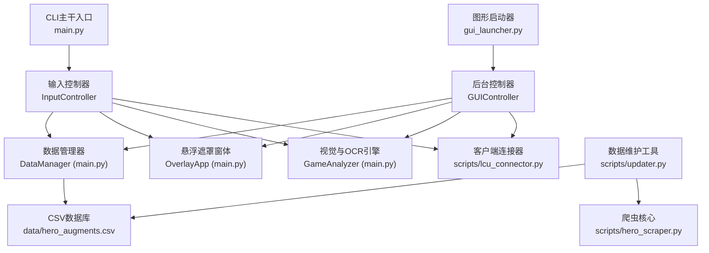
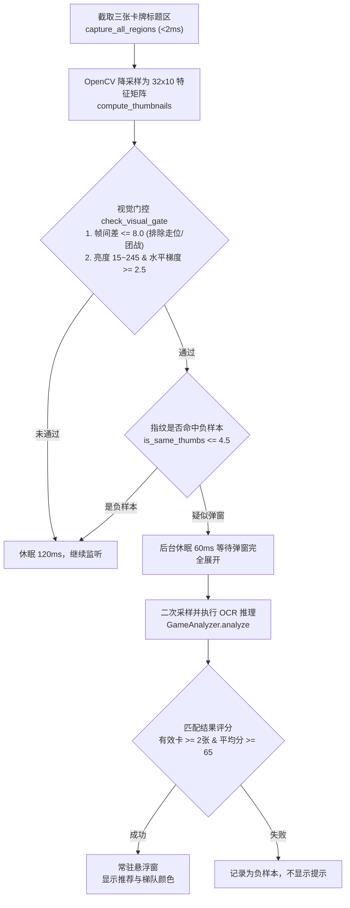

# ARAM 海克斯助手 · 长期技术约定与开发规范 (AGENTS.md)

> 本文档面向接手本项目的开发者与 AI Agent，集中记录项目的长期架构约定、运行约束、核心流水线机制与测试规范。
> 动态进度、当前任务与踩坑记录请移步 [STATUS.md](STATUS.md)。
> 项目入门与普通玩家指南请参考 [README.md](README.md)。

---

## 1. 项目定位与核心架构

`lol-aram-mayhem-hextech-helper` 是专为英雄联盟极地大乱斗“海克斯大乱斗”模式设计的辅助工具。
核心目标是在对局中通过计算机视觉与客户端通信，**零手动干预**地识别当前英雄与海克斯三选一弹窗，并提供基于 OP.GG 胜率的实时半透明悬浮推荐。

### 1.1 模块分层与代码清单



| 模块 / 文件 | 职责说明 | 关键约束与依赖 |
| :--- | :--- | :--- |
| [`gui_launcher.py`](gui_launcher.py) | 现代化图形界面启动器（GitHub Dark 主题）、系统托盘集成 (`pystray`)、主事件轮询 | 独立打包入口点，主线程负责 Tkinter，后台线程运行引擎 |
| [`main.py`](main.py) | 核心算法与悬浮窗实现：包含 `OverlayApp`（透明置顶悬浮窗）、`GameAnalyzer`（视觉门控与 OCR）、`DataManager`（数据索引）、`InputController`（命令行主控） | 核心算法枢纽，供 `gui_launcher.py` 导入复用 |
| [`scripts/lcu_connector.py`](scripts/lcu_connector.py) | 客户端本地 API 通信：支持进程信息/lockfile读取、LCU API 与 Live Client Data API (端口 2999) 自动探测英雄 | 请求短超时 (1.0~2.0s)、禁用 SSL 警告、英雄多格式别名映射 |
| [`scripts/config.py`](scripts/config.py) | 路径统一解析：兼容源码开发与 PyInstaller 冻结环境 (`sys.frozen`) | 全局单一路径源，严禁在其他模块用 `__file__` 随意相对寻址 |
| [`scripts/updater.py`](scripts/updater.py) | 数据维护工具：抽样校验、智能增量、全量抓取、精确打击以及 GitHub 备选下载 | 集成作者环境检测与 Git 自动推送功能 |
| [`scripts/hero_scraper.py`](scripts/hero_scraper.py) | 基于 Selenium 的 OP.GG 大乱斗海克斯胜率爬虫 | 依赖 Chrome 与 webdriver-manager |
| [`build.py`](build.py) | PyInstaller 一键打包脚本：收集 ONNX 模型、修剪冗余大型库、按时间戳隔离输出目录 | 生产构建入口，必须使用 `--onedir` 与 `--uac-admin` |
| [`tests/test_auto_detect.py`](tests/test_auto_detect.py) | 自动化单元测试：覆盖英雄名多格式解析、纯黑拦截、文字门控、运动过滤、指纹判等与单卡局部重算 | 持续集成与日常修改的首要验证网 |

---

## 2. 运行环境与核心约束

### 2.1 Python 版本强制约束 (3.9 ~ 3.12)
* **严禁使用 Python 3.13+**：
  * 本项目依赖的核心 OCR 推理引擎 `rapidocr_onnxruntime<=1.4.4`。在 Python 3.13 下，由于底层 ONNXRuntime 绑定与包内路径读取机制变动，会直接抛出 `KeyError: 'model_path'` 导致崩溃。
  * 推荐在本地通过 `uv` 管理：`uv venv --python 3.12`，随后执行 `uv pip install -r requirements.txt`。

### 2.2 操作系统与权限约定
* **必须管理员权限**：
  * 全局热键监听基于 `keyboard` 模块，Windows 下非管理员权限无法截获具有管理员权限运行的游戏客户端按键。
  * `psutil` 读取客户端进程命令行参数（包含 LCU 端口与授权 token）时，普通用户权限可能遭到拒绝。
  * 打包配置中已显式注入 `--uac-admin`。

### 2.3 游戏窗口与坐标适配约定
* **必须为“无边框窗口” (Borderless)**：全屏独占模式会阻止 Windows 透明悬浮窗置顶并可能导致截图黑屏。
* **等比缩放基准**：
  * 屏幕采样坐标以 **2K 分辨率 (2560 × 1440)** 为黄金基准。
  * `get_regions()` 函数根据主显示器物理宽高动态计算比例，已在 1080p (1920×1080)、2K (2560×1440) 和 4K (3840×2160) 下通过验证。任何对识别框的微调必须保持比例参数形式。

---

## 3. 关键业务机制与算法规范

### 3.1 全自动英雄感知流程 (LCU + Live API)
系统以 **1.2s ~ 2.5s** 自适应频率轮询本地接口，覆盖三大阶段：
1. **选人阶段 (ChampSelect)**: 请求 `/lol-champ-select/v1/session`，跟踪 `myTeam` 中本玩家的 `championId`。在选人阶段摇骰子或更换英雄时，1 秒内完成响应。
2. **对局进行阶段 (InProgress)**: 请求 `/lol-gameflow/v1/session` 获取 `gameData` 中的当前英雄。
3. **局内备用通道 (Live Client Data)**: 请求 `https://127.0.0.1:2999/liveclientdata/activeplayername` 与 `allplayers`。
4. **容错解析器规范 (`_resolve_champion_name`)**：
   * 客户端接口返回的可能为内部 key（如 `game_character_displayname_Ezreal`）、英文别名（`MonkeyKing`、`DrMundo`）、纯小写或带空格。
   * 必须由 `LCUConnector._resolve_champion_name()` 统一剥离前缀并对照 `champions.json` 转换为标准中文名（如“探险家”、“齐天大圣”）。

### 3.2 局内海克斯两阶段视觉门控流水线 (Fast-Track)
为兼顾**毫秒级响应**与**极低 CPU 占用**，严禁对游戏画面直接无脑进行 OCR。必须严格执行以下两阶段：



检测到进入对局后，OCR 确认首个海克斯弹窗时由界面显示“正在分析推荐”650ms，随后显示推荐。普通画面和后续候选在后台确认。

### 3.3 单卡 Reroll 局部增量刷新流水线
当悬浮窗正在显示期间：
1. 持续每 120ms 比对当前特征矩阵与上一帧基准。
2. 若画面变为低对比度背景，或三张卡的区域同时变化，清空旧遮罩并重新走弹窗确认流程。
3. 若画面仍然通过门控，但仅个别卡牌特征变化（玩家对单卡点击了掷骰子 Reroll）：
   * 等待 240ms 后重新截取变动卡牌。两次采样一致后用 OCR 核对卡名。
   * 卡名一致时只更新比对指纹。确认新卡后在变动位置短暂显示刷新提示，再一次性更新排序。

---

## 4. 开发与协作规范

### 4.1 单一事实原则 (Single Source of Truth)
* **路径事实**：所有路径从 [`scripts/config.py`](scripts/config.py) 引用，杜绝硬编码绝对路径。
* **英雄数据事实**：英雄与海克斯胜率以 [`data/hero_augments.csv`](data/hero_augments.csv) 为准，格式固定为 `["中文名", "英文名", "等级", "总排名", "等级内序号", "海克斯名称"]`。
* **状态与进展事实**：长期约定与架构规范记录于本文档，短期任务、在办卡点与复现日志记录于 [`STATUS.md`](STATUS.md)。

### 4.2 变更与测试规范
1. **代码修改必须可逆且聚焦**：避免跨模块大范围无上下文重构。
2. **测试必须先于提交**：任何涉及 LCU 英雄解析、视觉门控阈值、指纹比对或单卡局部重算的逻辑修改，必须本地运行通过自动化测试套件：
   ```bash
   uv run python tests/test_auto_detect.py
   # 或
   .\.venv\Scripts\python.exe tests/test_auto_detect.py
   ```
3. **打包验证规范**：
   * 修改依赖或静态资源后，运行 `python build.py` 打包，检查生成目录下是否含有 `rapidocr_onnxruntime` 核心模型与配置文件。
   * 打包时必须使用黑名单机制过滤大型数据科学库（如 `torch`、`pandas`、`scipy`），保证产物体积轻量稳定。
